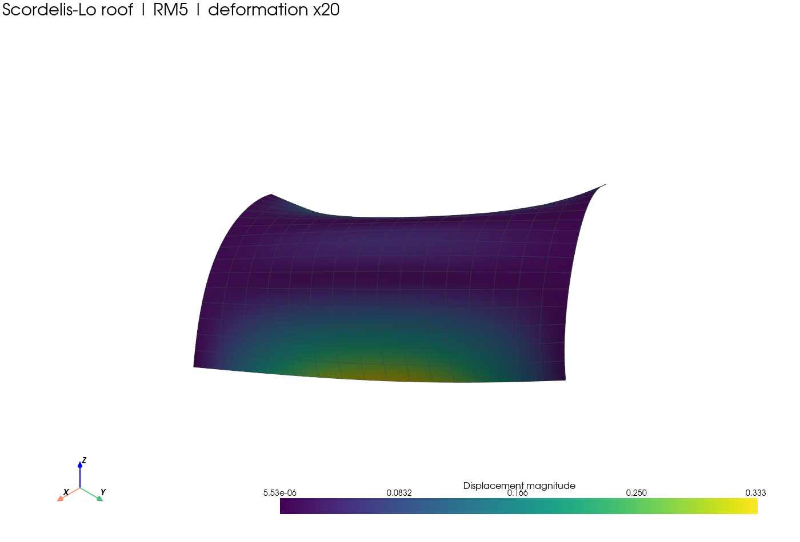
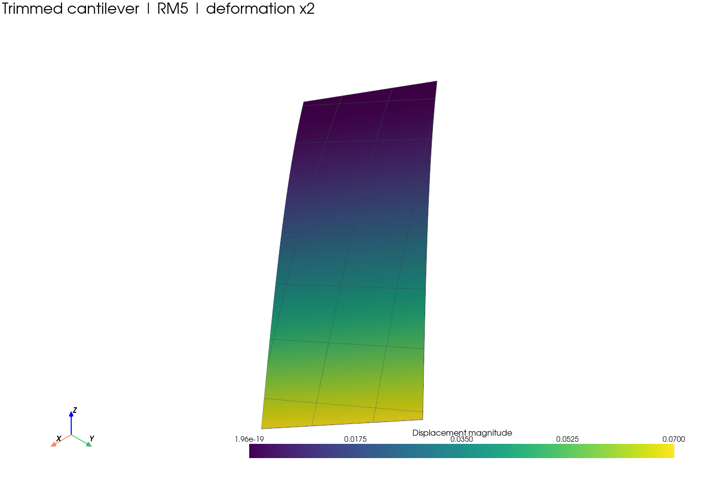
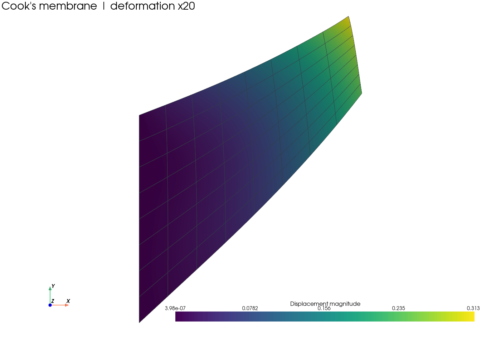

# IGAeasy

**Isogeometric analysis in Python, with readable examples and verified structural benchmarks.**

IGAeasy combines THB- and LR-spline discretizations with linear membranes and
Reissner-Mindlin / Kirchhoff-Love shells. It supports trimmed domains, local
refinement and strong or weak boundary conditions in the documented cases.



*Scordelis-Lo roof with RM5 shells. Colors show the computed displacement
magnitude; deformation is magnified 20 times for visualization.*

## What is included

- THB- and LR-spline spaces with shared basis evaluation utilities.
- Linear plane-stress membranes; RM6, RM5, hierarchical RM5 and canonical KL shells.
- Fitted and trimmed setups, including locally refined verification cases.
- Strong Dirichlet conditions and documented penalty/Nitsche formulations.
- Sparse assembly, linear solvers and preconditioning utilities.
- Interactive displacement, stress and strain visualization with selectable overlays.
- Standalone benchmarks and separate convergence/verification studies.

The initial release focuses on **linear static structural analysis**. Supporting
utilities do not imply that every geometry, discretization or boundary-condition
combination has been verified.

## Install

Use Python 3.11 or newer:

```bash
git clone https://github.com/christophhollweck/IGAeasy.git
cd IGAeasy
python -m pip install -e .
```

Select that Python environment in your IDE and open one of the standalone
examples below. Each setup can be executed directly, including with the Python
Run button in VS Code.

## Try an example

| Example | Setup | Reference |
|---|---|---|
| Scordelis-Lo roof | [RM5 roof](IGAeasy/examples/shells/benchmarks/scordelis_roof/rm5.py) | Published numerical shell benchmark |
| Simply supported plate | [RM5 plate](IGAeasy/examples/shells/benchmarks/simply_supported_plate/rm5.py) | Navier series |
| Trimmed cantilever | [RM5 cantilever](IGAeasy/examples/shells/trimmed/flat_cantilever_rm5.py) | Analytical strip solution for the stated parameters |
| Cook's membrane | [Plane-stress membrane](IGAeasy/examples/membranes/benchmarks/cooks_membrane.py) | Documented numerical reference interval |

See the [example guide](IGAeasy/examples/README.md) for the full collection.
Benchmark folders contain individual setups; verification folders contain
convergence studies.

| Trimmed cantilever | Cook's membrane |
|---|---|
|  |  |

*Actual computed displacement fields from the included examples. Displayed
deformations are magnified 2 times and 20 times, respectively. These images
are visualizations, not independent validation evidence.*

## Validation and limits

The isolated structural export passed **298 regression tests**, with no failures,
errors or skipped tests. All **44 installed example modules** import successfully,
and the installed Cook benchmark lies in its documented reference interval.

```bash
python -m unittest discover -s tests -t .
```

Read the [validation matrix](docs/shell_validation_matrix.md),
[benchmark references](docs/benchmark_references.md) and
[execution record](docs/release_execution.md) for the tested parameters and
dependencies. Known limits include the documented KL hemisphere discrepancy,
RM point-load behavior, fitted geometry approximation and extreme-cut conditioning.
This is research software; passing the included tests is not a guarantee for
arbitrary inputs or a replacement for independent engineering verification.

## License

Copyright 2026 Christoph Hollweck. Released under the [MIT License](LICENSE).
