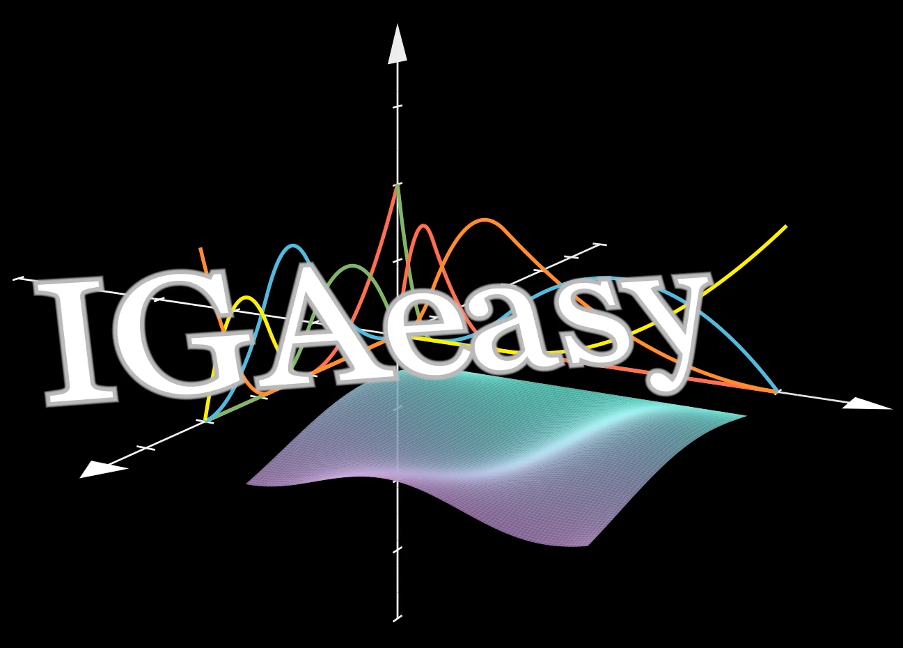
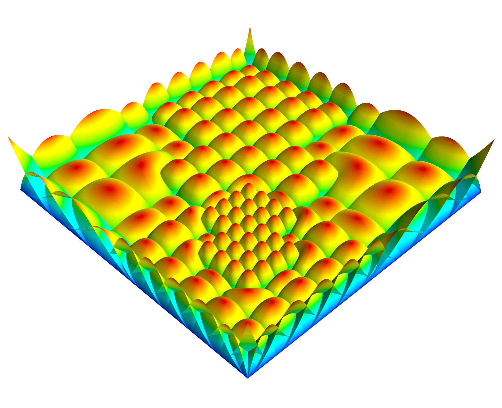
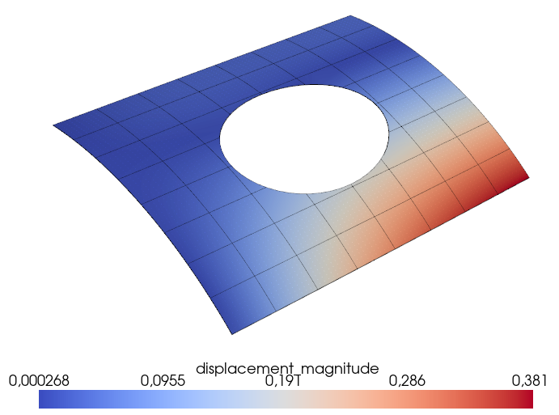
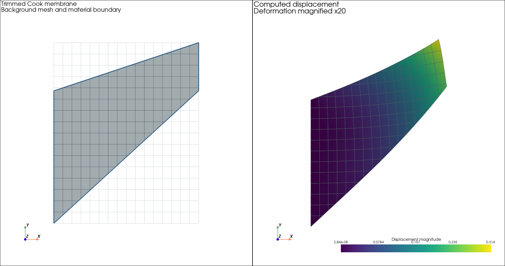

# IGAeasy



**IGAeasy** is a modular and research-friendly Python framework for **Isogeometric Analysis (IGA)**.

It focuses on clear structure, readability and extensibility, with support for
locally refined **LR- and THB-splines**. The current release provides linear
membrane, Reissner-Mindlin shell and Kirchhoff-Love shell formulations on fitted
and trimmed geometries.

The computational core is designed for two-dimensional manifolds, including
planar domains and surfaces embedded in three-dimensional space.

<table style="width: 100%; table-layout: fixed;">
  <tr>
    <td style="text-align: center; vertical-align: top;">
      
      <p><b>THB basis: three levels of refinement</b></p>
    </td>

    <td style="text-align: center; vertical-align: top;">
      
      <p><b>Trimmed roof with a circular opening</b></p>
    </td>

    <td style="text-align: center; vertical-align: top;">
      
      <p><b>Trimmed and locally refined spline geometry</b></p>
    </td>
  </tr>
</table>

## 💡 Features

- **Spline types:** LR-splines and truncated hierarchical B-splines.
- **Structural elements:** Linear membranes, Reissner-Mindlin shells and Kirchhoff-Love shells.
- **Trimming:** Analysis of geometries defined by trimming curves.
- **Local refinement:** Refine selected regions while preserving the represented geometry.
- **Boundary conditions:** Strong Dirichlet conditions and weak enforcement using penalty or Nitsche methods for the documented formulations.
- **Postprocessing:** Interactive visualization of displacement, stress and strain fields.
- **Verification:** Analytical solutions, manufactured solutions and established structural benchmarks.
- **Modular design:** Separate components for geometry, discretization, materials, elements, assembly and solution.

## 📊 Examples

The example collection contains complete, readable setups for individual
problems. Convergence studies are organized separately in the verification folders.

Examples include:

- Simply supported plates.
- The Scordelis-Lo roof.
- An open hemisphere.
- The Raasch hook.
- Fitted and trimmed Cook's membrane.
- A trimmed cantilever with an analytical reference solution.



*Trimmed Cook's membrane on a rectangular background mesh. The right panel shows
the computed displacement magnitude; deformation is magnified 20 times.*

The interactive viewer allows deformation, element boundaries and
boundary-condition overlays to be shown or hidden. Available result fields
can be selected within the same window.

See the [example guide](IGAeasy/examples/README.md) for an overview.

## 📦 Package Structure

```text
IGAeasy/
├── assembler/               # Global matrix and vector assembly
├── constraints/             # Strong/weak Dirichlet conditions and DOF constraints
├── differential_geometry/   # Surface geometry and derivatives
├── elements/                # Membrane and shell formulations
├── error_norms/             # Error evaluation
├── examples/                # Benchmarks and verification studies
│   ├── shells/              # Shell examples
│   └── membranes/           # Membrane examples
├── geometry/                # Geometry creation and transformations
├── loads/                   # Point, line and surface loads (Neumann conditions)
├── manufactured_solutions/  # Reference fields for verification
├── material/                # Material definitions
├── numerical_integration/   # Quadrature and integration
├── postprocessing/          # Result evaluation and visualization
├── preconditioning/         # Linear-system preconditioners
├── solver/                  # Linear-system solution
├── splines/                 # LR- and THB-spline discretizations
└── trimming/                # Trimmed-domain representation

tests/                       # Automated regression tests
docs/                        # Mathematical notes and validation records
```

## 🚀 Getting Started

Use **Python 3.11 or newer**, preferably in a virtual environment.

Clone the repository:

```bash
git clone https://github.com/christophhollweck/IGAeasy.git
cd IGAeasy
```

Install the package and its dependencies:

```bash
python -m pip install -e .
```

Select this Python environment in your editor and open an example script.
In VS Code, the standalone examples can be executed using the **Python Run button**.

For example, start with:

- [Scordelis-Lo roof](IGAeasy/examples/shells/benchmarks/scordelis_roof/rm5.py)
- [Cook's membrane](IGAeasy/examples/membranes/benchmarks/cooks_membrane.py)
- [Trimmed Cook's membrane](IGAeasy/examples/membranes/trimmed/cooks_membrane.py)
- [Trimmed cantilever](IGAeasy/examples/shells/trimmed/flat_cantilever_rm5.py)

Dependencies are specified in [pyproject.toml](pyproject.toml).

## 🧪 Verification

The release passed **298 automated regression tests**. Verification combines
analytical and manufactured solutions, spatial rotation checks, refinement
studies and structural benchmarks.

Run the tests with:

```bash
python -m unittest discover -s tests -t .
```

The [validation matrix](docs/shell_validation_matrix.md) documents the tested
configurations and known limitations. The current release focuses on
**linear static membranes and shells**. The [execution record](docs/release_execution.md)
contains the regression and installed-package checks.

## 🚧 Ongoing Development

IGAeasy is under active development. Additional capabilities will be included
in public releases as their implementation and verification mature. Planned
extensions include the shifted boundary method (SBM), heat conduction,
eigenvalue problems, nonlinear formulations, multipatch coupling and
third-medium contact.

Features are released together with examples and validation evidence once
they have been sufficiently tested for their documented scope.

## 🤝 Contributing

Contributions are welcome — from bug reports and documentation improvements
to new examples, benchmarks and numerical methods. Feel free to open an issue
to discuss an idea or submit a pull request.

For larger extensions, please open an issue first so we can discuss the
formulation, implementation and verification approach.

## 📌 License

IGAeasy is released under the [MIT License](LICENSE).

Copyright © 2026 Christoph Hollweck.

## 🙌 Acknowledgements

A special thanks to [qTipTip](https://github.com/qTipTip), whose public
repositories and open-source contributions inspired the initial implementation
of LR- and THB-splines in this project.
